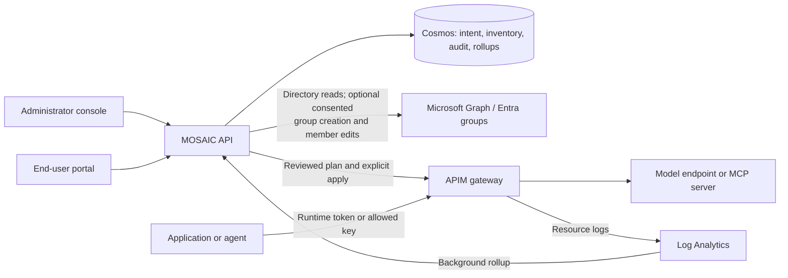
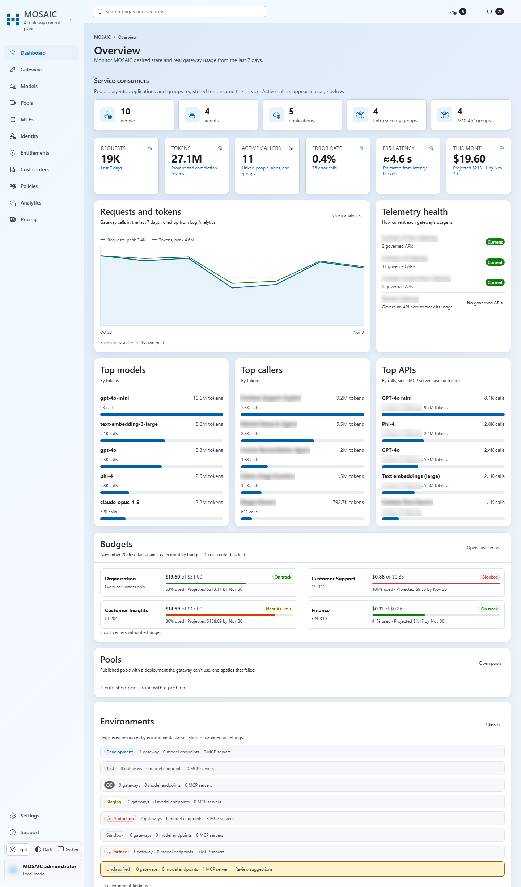
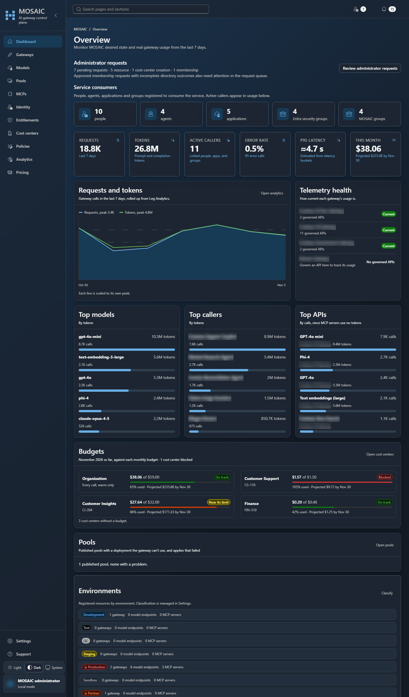
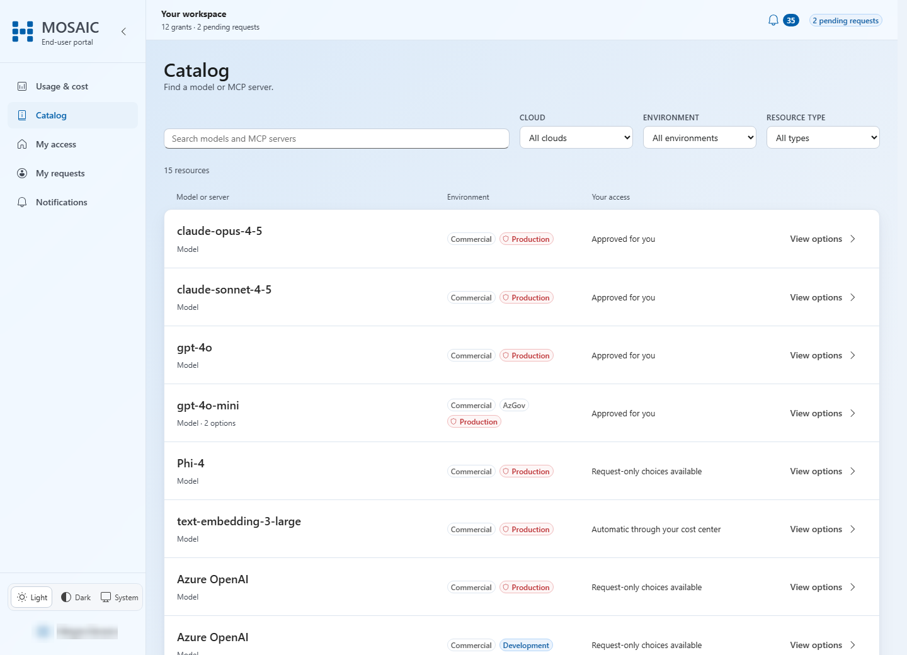
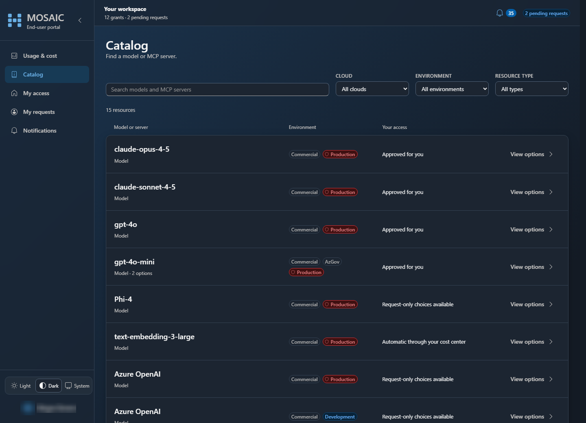

# MOSAIC

**Model Operations, Security, Access, Identity and Control**

MOSAIC is a governance and operations control plane for AI models and MCP servers exposed through
Azure API Management. Administrators discover resources, publish reviewed gateway configurations,
grant access, and track usage and estimated cost. People use a separate portal to find models,
request access, and get connection details.

**MOSAIC manages the gateway; it is not the inference proxy.** Applications call APIM directly.
APIM enforces the last applied access policy and forwards allowed requests to the model or tool.

## Documentation

Start with the [architecture](docs/architecture.md), [workflow diagrams](docs/workflows.md), or
[FAQ](docs/faq.md). The [documentation index](docs/README.md) organizes the complete guides by task.

| I want to... | Read |
| --- | --- |
| Understand the components, identities, and trust boundaries | [Architecture](docs/architecture.md) |
| Follow a request from approval to a live call | [Workflows](docs/workflows.md) |
| Answer questions about Entra, limits, billing, and failure behavior | [FAQ](docs/faq.md) |
| See the applications | [Selected screenshots](#screenshots) and [full gallery](docs/gallery.md) |
| Run locally or deploy to Azure | [Development](docs/development.md) and [deployment](docs/deployment.md) |
| Explore the opt-in multi-environment customer demo | [Federal demonstration estate](docs/federal-demo.md) |
| Register gateways and model endpoints | [Gateways](docs/gateways.md) and [model endpoints](docs/model-endpoints.md) |
| Publish models or combine deployments | [Model publishing](docs/model-publishing.md) and [model pools](docs/model-pools.md) |
| Grant access and connect a client | [Grants](docs/access.md), [Entra model calls](docs/call-models-with-entra-tokens.md), and [MCP connections](docs/connect-to-mcp-servers.md) |
| Set up team access and real Entra membership | [Cost-center setup](docs/cost-centers.md#set-up-cost-centers) |
| Understand chargeback and spending controls | [Cost centers](docs/cost-centers.md), [usage](docs/usage-analytics.md), [pricing](docs/pricing.md), and [budgets](docs/budgets-and-alerts.md) |
| Derive and approve customer-specific billing rates | [Billing data, credentials, and schedules](docs/pricing.md#billing-data-import-review-publish) |
| Check capabilities, limitations, and direction | [Capabilities and roadmap](docs/overview.md) |

## What MOSAIC does

- **Discover and explain:** register existing gateways, model endpoints, and MCP servers; inspect
  their inventory, access readiness, and policies without displaying policy XML or secret values.
- **Publish deliberately:** review a deterministic plan, then explicitly apply it to a gateway in
  manage mode. Importing an existing API is not the same as publishing or enforcing it.
- **Govern access:** grant an exact resource to a person, application, agent identity, or Entra
  security group, under a cost center, with token and request limits where supported. Each custom
  center uses a dedicated Entra group for membership and chooses Automatic, Request-only, or
  Not available for each exact model, pool-model offering, or MCP server.
- **Make access usable:** provide a catalog, access requests, approvals, and caller-scoped
  connection details, including inherited access and **My cost centers** for membership,
  administrator-published discovery, and creation/join requests. Administrator Settings controls
  those request capabilities; discovery is opt-in for each center. Approval
  saves intent; a separate gateway apply makes resource access effective.
- **Operate the estate:** pool compatible model deployments, inspect health, and report usage,
  sourced price estimates, cost-center spend, and asynchronous budget alerts or blocking.
- **Review billing-derived rates:** import supported USD Azure, AWS, or GCP billing extracts or
  retrieve them read-only, inspect evidence and deployment bindings, then explicitly publish dated
  rates. Opt-in monthly refresh prepares drafts only; see [Pricing](docs/pricing.md).

See the [capability inventory](docs/overview.md#what-is-implemented) for supported paths and opt-ins.
Provider detection alone does not imply support for publishing, token metering, or pricing.

## Architecture and trust boundaries

Three paths have different timing and responsibilities: **configuration changes** are reviewed
and applied, **runtime authorization and limits** execute in APIM, and **reporting and dollar-budget
feedback** run asynchronously. An inference call does not query MOSAIC, Cosmos, Graph, or Log
Analytics for authorization.

For Entra security-group grants, APIM matches object IDs in the validated runtime token. It needs
network access to Entra's public metadata and signing keys, not Graph directory-read permissions.
MOSAIC's API identity separately needs administrator-consented Graph reads for directory lookup
and verification. Optional, separately consented permissions let administrators create a center's
group and edit its actual Entra membership; APIM needs none of those permissions.
See [identity boundaries](docs/architecture.md#which-identity-needs-which-access) and the
[security-group FAQ](docs/faq.md#does-apim-need-microsoft-graph-permissions-to-check-security-groups).

The [architecture guide](docs/architecture.md) includes component and identity-dependency diagrams,
permissions, state ownership, security model, and reconciliation boundary.

## Screenshots

The console gives administrators the estate view; the portal gives people their own catalog,
access, and usage. These images show only the script-seeded fictional Contoso estate, with
identifiers and secrets blurred. Directory data and checks are simulated, not live Entra evidence.

<table>
  <tr>
    <th width="50%">Light</th>
    <th width="50%">Dark</th>
  </tr>
  <tr>
    <td></td>
    <td></td>
  </tr>
  <tr>
    <td colspan="2"><b>Console overview.</b> Inspect gateway usage, estimated cost, telemetry freshness,
    budgets, pools needing attention, and environment inventory. Identity counts open the corresponding
    administrative sections.</td>
  </tr>
  <tr>
    <td></td>
    <td></td>
  </tr>
  <tr>
    <td colspan="2"><b>Portal catalog.</b> Find model offerings by cloud, environment, eligible cost center, and type, and
    inspect existing access. Open an exact offering's access options without leaving the catalog.</td>
  </tr>
</table>

The [full gallery](docs/gallery.md) includes publishing reviews, model pools, Entra directory
lookups, grants, cost centers, budgets, analytics, notifications, Government connections, and
[billing-rate review](docs/gallery.md#billing-data-and-rate-review).
It also shows [cost-center requests and Automatic access](docs/gallery.md#cost-center-requests-and-automatic-access),
including membership discovery and requests, administrator controls, and incomplete setup
rather than treating approval as usable access.
[Screenshot maintenance](docs/screenshots.md) explains capture, redaction, and the shot inventory.

## Important boundaries

APIM's native limits are not the same as the analytics figures. Usage is rolled up from gateway
logs every 15 minutes by default; priced usage is an estimate, not the provider invoice. Dollar-budget
blocking normally trails usage by 15-30 minutes and can overshoot. See the [FAQ](docs/faq.md).

Estimates use applicable approved billing-derived, manual, or public rates. Billing-derived rates
reflect a completed source month's contract-discounted, amortized consumption, excluding tax and
one-off credits. They are USD-only, not invoice reconciliation, FX, or a percentage/fixed-dollar
markup feature. Publication defaults to today's UTC date; explicit backdating can change past
reports and the next budget check's blocking decisions. See [pricing limits](docs/pricing.md#limits).

Government resources can be managed from commercial MOSAIC through a separate management identity;
their runtime offerings are key-only. Management metadata and usage enter commercial MOSAIC, so
this is not a sovereignty claim. See [Azure Government](docs/azure-government.md).

Generic MOSAIC-local groups do not authorize runtime calls. Experimental managed cost-center
rosters are superseded by [Entra-backed cost centers](docs/cost-centers.md). A center defines
charging and resource policy, its dedicated Entra group defines membership, and an applied grant
authorizes one exact resource. Automatic access uses a stable group grant, not one grant or key per
member; individual key paths remain explicit. General is exempt from the mandatory group, and
Government offerings are excluded from this new workflow. See
[groups and permissions](docs/faq.md#does-mosaic-create-groups-or-change-entra-membership).

The direct Members listing uses Graph beta to include service principals omitted by v1.0. That
listing dependency is preview and not supported for production use, separate from APIM's stable
JWT group-grant check. Live interoperability for the redesign has not been proved; see
[membership and evidence limits](docs/cost-centers.md#members-and-who-may-charge-a-cost-center).

## Operator reference

The detailed sections previously on this page now have their own guides. Existing README section
links below lead to the relevant guide.

| Topic | Guide |
| --- | --- |
| Capabilities and direction | [Inventory and roadmap](docs/overview.md) |
| Local setup and contribution | [Development](docs/development.md) |
| Azure provisioning and configuration | [Deployment](docs/deployment.md) |
| State, security, and reconciliation | [Architecture](docs/architecture.md) |
| Gateway inventory and MCP registration | [Gateways](docs/gateways.md) |
| Backend registration and readiness | [Model endpoints](docs/model-endpoints.md) |
| Reviewed model publishing | [Publishing and unpublishing](docs/model-publishing.md) |
| Routing across deployments | [Model pools](docs/model-pools.md) |
| Grants, MCP access, and interrupted operations | [Access and recovery](docs/access.md) |
| Live gateway and UI verification | [Verification](docs/verification.md) |
| Environment classification | [Environments](docs/environments.md) |
| Charging and spending controls | [Cost centers](docs/cost-centers.md) and [budgets](docs/budgets-and-alerts.md) |
| Usage pages, setup, and API routes | [Analytics reference](docs/analytics-reference.md) |

## Quality checks

[Development and quality checks](docs/development.md#quality-checks) contains the validation commands
and contribution rules; [CI](.github/workflows/ci.yml) defines the required checks.

## License and support

MOSAIC is [MIT-licensed](LICENSE) repository software, not a separately supported Azure service.
Deployment and ongoing operation remain the adopting organization's responsibility. Report security
issues through [SECURITY.md](SECURITY.md); see [ownership and support](docs/faq.md#who-operates-and-supports-mosaic).
