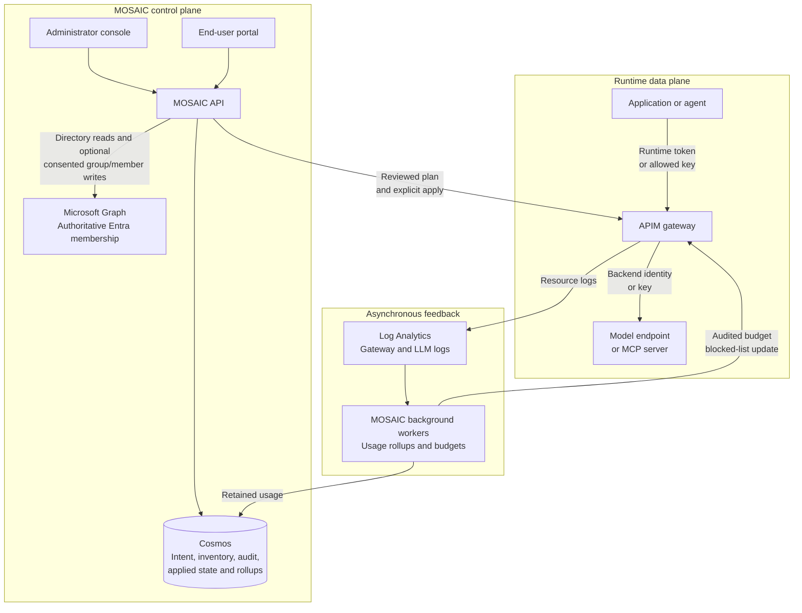
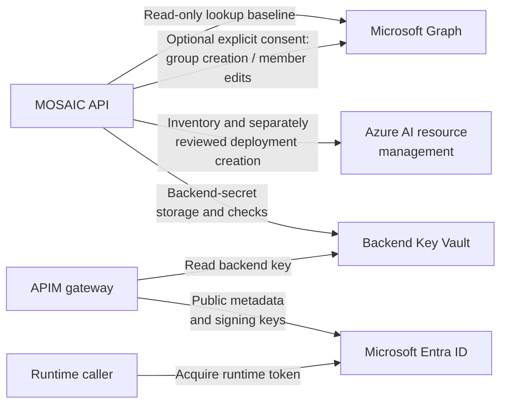

# MOSAIC architecture

[Documentation](README.md) | [MOSAIC](../README.md)

- [Architecture and trust boundaries](#architecture-and-trust-boundaries)
- [Which identity needs which access](#which-identity-needs-which-access)
- [Three paths, three consistency boundaries](#three-paths-three-consistency-boundaries)
- [Data model and Cosmos layout](#data-model-and-cosmos-layout)
- [Security model](#security-model)
- [Reconciliation boundary](#reconciliation-boundary)

## Architecture and trust boundaries

MOSAIC manages AI access and operations around Azure API Management; APIM remains the runtime
gateway. Read the [workflow diagrams](workflows.md) for individual journeys and the [FAQ](faq.md)
for concise answers about permissions, timing, costs, and failure behavior.

The reference deployment runs a FastAPI API, React administrator console, and separate React portal
in three containers on Linux Web Apps. It uses Cosmos for governance and retained usage, Key Vault
for backend secrets, and Azure Monitor for operational and gateway telemetry. Registered gateways
and model resources can exist outside that deployment.

There is **no inference-time authorization callback** from APIM to MOSAIC, Cosmos, Graph, or
Log Analytics. The diagram's management and telemetry arrows are not extra hops in a model call.
Backend requests can still depend on Entra, Key Vault, and networking according to their configured
authentication. API/application telemetry in Application Insights and optional notification
providers are additional operational integrations, not authorization sources.

The administrator console and the end-user portal are separate applications with separate
Entra registrations and separate app roles, so they are independently governable. The portal
reaches only `/api/v1/portal/*` and the current-user `/api/v1/me/*` routes. Every one of them is
scoped to the caller's own token, and none accepts a subject or requester parameter. The console
first asks `GET /api/v1/console/me` which MOSAIC role the caller holds, and renders only for
`Admin`; anyone else sees a single page that says what their account has and what to ask for. See
[ADR 0008](adr/0008-portal-identity-and-role-separation.md).

| Concern | Source of truth | MOSAIC responsibility |
| --- | --- | --- |
| Governance intent | Cosmos DB | Store tenant-scoped desired state and audit mutations |
| Runtime traffic and enforcement | APIM | Apply reviewed configuration on managed gateways; two scoped background/instrumentation write exceptions are described below |
| Identity objects, group membership, and authentication | Microsoft Entra ID | Store references and operation state; validate tokens/app roles; read directory metadata; optionally create and edit verified center groups with separate consent |
| Cost-center resource policy | Cosmos DB | Bind each custom center exclusively to one Entra group and configure exact-resource access; do not keep an editable shadow roster |
| Backend credential references | Key Vault | Store secret URIs only, never secret values |
| APIM subscription keys | APIM | Retrieve only for an explicitly authorized reveal; never persist or cache a copy |
| Foundry deployments | Existing Azure AI/Foundry resources | Read inventory by default; create a new deployment only after endpoint opt-in and explicit review; report, never grant, gateway runtime access |
| Traffic/token telemetry | Azure Monitor stack | Read API Management's resource logs from Log Analytics and roll them up into Cosmos; set API diagnostics only on APIs MOSAIC published on managed gateways |

MOSAIC never silently substitutes in-memory data or local authentication in Azure. Both are
explicit local/test modes and application startup rejects them when `MOSAIC_ENVIRONMENT=azure`.

## Which identity needs which access

These are separate identities and permission checks, not one tenant-wide grant.

Supporting dependencies are separate from the control/runtime/feedback paths above:

| Identity/component | Access it needs | What that does not grant |
| --- | --- | --- |
| Administrator/deployer | Provisioning permissions, app-registration/consent administration, and scoped Azure role-assignment rights | Permission for every signed-in person to call every model |
| MOSAIC API managed identity, baseline | Cosmos and vault access; scoped ARM reads/writes; consented Graph directory reads; gateway log reads | Automatic inference access or group-write powers from the read permissions alone |
| Same API identity, optional group management | Separately consented group creation and member-write permissions, constrained by MOSAIC to a center's verified bound group | App-registration consent, runtime app-role assignment, arbitrary directory mutation, or automatic group deletion |
| APIM gateway identity | Backend inference permissions and network reachability; Key Vault secret reads where configured | No Graph permission is needed for group authorization; no access to external management credentials |
| Runtime caller | Runtime-audience token with invocation scope/app role, matching applied grant, and custom-center group claim; or an allowed individual-grant key | Model access merely from a MOSAIC `Admin`/`User` role, default-center preference, or group membership without a resource grant |
| Government management principal | Separately configured Government ARM/log access | Commercial Entra runtime token authorization on Government offerings |

For directory experiences, MOSAIC's API uses Graph application permissions `User.ReadBasic.All`,
`GroupMember.Read.All`, and `AgentIdentity.Read.All`. Optional application lookup/admin recipient
discovery uses separately consented `Application.Read.All`; optional photos use
`ProfilePhoto.Read.All`. These remain the **read-only lookup** capabilities, not group management.

A separate, narrow control-plane adapter manages cost-center groups only when the API identity
has explicit optional consent:

| Optional capability | Graph application permission |
| --- | --- |
| Create a center group, explicitly owned by the API service principal | `Group.Create` |
| Add/remove user members | `GroupMember.ReadWrite.All` |
| Add service principals, including managed identities and app-only agent identities | `GroupMember.ReadWrite.All` **and** separately consented `Application.ReadWrite.All` |

These can be tenant-wide permissions; MOSAIC's target restrictions do not narrow the tenant consent
itself. A MOSAIC Admin role is not consent. Group setup rejects unsupported group types and never
grants these permissions automatically during ordinary deployment or approval.
Human-owner assignment needs the appropriate additional lookup permission; cost-center contact
emails are not Entra owners. See [optional setup](deployment.md#optional-cost-center-group-management).

The direct Members list uses Graph **beta** to include service principals, the
[documented workaround for the v1.0 omission](https://learn.microsoft.com/en-us/graph/api/group-list-members?view=graph-rest-1.0).
This listing dependency is preview, subject to change, and
[not supported for production use](https://learn.microsoft.com/en-us/graph/api/group-list-members?view=graph-rest-beta).
It is a control-plane limitation, not a beta dependency of APIM's stable JWT group-grant check.
No live group-management or gateway interoperability is established by the fictional adapter tests.

**APIM does not need those Graph permissions to check a security-group grant.** Entra places
security-group object IDs in the runtime token; APIM matches those IDs after token validation.
It needs network access to the configured Entra public OpenID metadata and signing-key endpoints.
Configure group claims on the runtime registration. Stale token claims and group overage are
limitations of this design, not reasons for APIM to call Graph.

For custom centers, the group defines membership and the center defines resource policy. Automatic
access creates one stable group grant per exact resource. Adding a member performs Graph work,
not per-member entitlement creation or APIM policy writes. Individual token grants also require the
center's group claim; direct-grant precedence does not bypass it. General is exempt by built-in
identity, and Government is excluded from the new workflow. See [cost centers](cost-centers.md).

Runtime model permissions are `Models.Invoke` for delegated callers and
`Models.Invoke.Application` for applications. MCP has separate
`Mcp.Invoke` / `Mcp.Invoke.Application` permissions and grants. MOSAIC control-plane roles use a
different audience. See [Entra model calls](call-models-with-entra-tokens.md),
[agent calls](call-models-with-agent-identities.md), and
[MCP connections](connect-to-mcp-servers.md).

## Three paths, three consistency boundaries

| Path | State and timing | Failure/consistency boundary |
| --- | --- | --- |
| Configuration | Desired intent, observed inventory, deterministic reviewed plan, explicit apply, audited result | Approval alone does not publish; failed applies need explicit inspection/recovery; no continuous drift repair |
| Runtime | APIM validates credentials against the last applied grant and uses native limits | Does not wait for MOSAIC or reporting; token membership can be stale and distributed counters are not an exact global ledger |
| Reporting/budgets | Gateway logs, Log Analytics ingestion, default 15-minute Cosmos rollups, sourced pricing, budget evaluation | Delayed estimates, not an invoice; dollar-budget blocking normally trails usage by 15-30 minutes and can overshoot |

Directory operations introduce a separate consistency boundary within the control plane. Save
center setup and operation intent before calling Graph; Graph and Cosmos are not one transaction.
A failed/unknown creation leaves recoverable setup, not an invented success or a second create.
Keep external I/O outside short Cosmos-only leases. Capability observations are read-only and
never create/delete a test group.

A successful member write is not immediate token propagation or individual-key revocation.
Human access tokens normally last 60-90 minutes from issuance; actual remaining `exp` matters.
Managed-identity token/authorization caching can last around 24 hours per resource. Existing keys
require explicit recheck and revoke/apply work; out-of-band membership edits have no continuous
directory watcher. Keep setup, directory-operation, propagation, per-resource apply, and key
revocation statuses distinct. See [removal consequences](cost-centers.md#removing-a-member).

Normal APIM configuration changes require a gateway in `manage` mode, verified write access, a
reviewed plan, and explicit apply. Two scoped exceptions are audited: enabling owned-API
diagnostics/logger instrumentation and updating the budget blocked-cost-center named value.
Neither is an inference-time authorization query.

If MOSAIC is unavailable, existing gateway routes retain their applied configuration, but new
applies, revocations, credential reveal, reporting, and budget updates can stall. That separation
does not remove APIM/backend/network dependencies or promise uninterrupted service.
See [workflows](workflows.md) and [budgets](budgets-and-alerts.md).

## Data model and Cosmos layout

Every entity contains `tenantId`; this initial deployment is single-tenant but the data contract is
not. The domain distinguishes:

- `ModelEndpoint`: a registered Azure OpenAI, Azure AI Foundry, AWS Bedrock, or OpenAI-compatible
  endpoint, its verified control-plane access, per-gateway runtime readiness, and, for an endpoint
  reached with an API key, the deployments or Bedrock model IDs an administrator declared on it
- `ModelEndpointSyncRun`: the outcome of one model discovery run
- `CatalogModel`: provider model identity/version
- `ModelDeployment`: callable deployed endpoint
- `Principal` (users, applications, managed identities, agent identities, agent users and Entra
  security groups), `Group`, `GroupMembership`; the latter two describe generic local groups,
  not an authoritative cost-center roster
- `EnvironmentCatalog`: the tenant's environments, which are production-class, which other
  environments each one's gateways also accept endpoints from, and whether classification is
  required
- `Gateway`: a registered API Management service, its verified access, and its inventory summary
- `GatewaySyncRun`: the outcome of one inventory synchronisation
- `ModelApi`: an API Management API an administrator adopted as a governed model endpoint
- `McpServer`: an API Management MCP server an administrator adopted
- `McpEndpoint`: a registered MCP server MOSAIC connects to and reads tools from
- `Publication`: intent to expose one model deployment through one gateway, plus the API Management
  resources an apply created and whether MOSAIC created each one
- `PublishPlan`, `PublishRun`: the reviewed changes and the audited result of applying them
- `Entitlement`: a grant of a governed resource to a user, group, or application, charged to one
  cost center, its token and request limits, and the binding that realizes it in API Management: a
  product or subscription, or the grant tag an applied publication emits at the gateway
- `AccessRequest`: a portal user's individual request for an eligible Request-only resource and
  the cost center they chose
- Cost-center creation requests: a separate request kind with a proposed name, justification,
  optional group suggestion, and a link to the single center created by approval
- `CostCenter`: charging/resource policy, code, responsible contacts, verified exclusive Entra
  binding and setup state, exact-resource modes, keys switch, per-person defaults, and pooled
  quotas; `CostCenterSettings` names the tenant's default preference
  ([ADR 0030](adr/0030-entra-backed-cost-centers.md))
- Directory operation records: small retained intents/results for group provisioning and direct
  member changes, including failures and uncertain outcomes; not a full membership snapshot
- `Budget`: a cost center's or the organization's monthly amount, thresholds, recipients, and
  whether it blocks at 100%; `EmailSettings`: the Graph mailbox object ID, configuration revision,
  budget-email switch, and last explicit test ([email setup](notification-setup.md))
- `CredentialReference`: Key Vault secret URI only
- `PriceVersion`: a price an administrator added, or a new version of a listed one, with the day it
  takes effect, its source, and a note; never edited or deleted
- `EndpointPricing`: an administrator's cloud and region for a model endpoint, and the deployment
  type and PTUs of deployments MOSAIC can't read
- `PolicyRevision`, `SyncOperation`, `AuditEvent`
Cosmos uses:

| Container | Partition key | Purpose |
| --- | --- | --- |
| `desired-state` | `/tenantId` | Control-plane entities, tenant-local queries, and transactional audit outbox |
| `sync-operations` | `/tenantId` | Gateway and endpoint sync runs, publish plans, and publish runs |
| `observed-state` | `/tenantId` | What MOSAIC observed in each registered gateway |
| `audit-events` | `/tenantId` | Append-only administrator mutation history |
| `usage-rollups` | `/tenantId` | Gateway usage rolled up from Log Analytics, per day and per month ([ADR 0019](adr/0019-usage-telemetry.md)), and each budget's state this month and what each gateway's blocked list holds ([ADR 0023](adr/0023-budgets-and-notifications.md)) |

`observed-state` is deliberately separate from `desired-state`. It is disposable, rebuilt on every
sync, and churns far more than administrator-authored governance intent. Observed documents use
deterministic IDs so a re-sync upserts in place; anything absent from the new snapshot is swept.

MOSAIC's local governance-record mutations and their audit records commit atomically to `desired-state`. The repository then
projects each outbox record into `audit-events`; a projection failure leaves the durable outbox record
for readiness-driven retry and is emitted to structured logs rather than failing an already-committed
administrator request.

That local transaction does not include Entra or APIM. Exclusive directory/group reservations,
conditional operation results, and idempotent request-to-center links protect partial progress
without treating a Graph correlation ID or matching group display name as an idempotency guarantee.
Membership is paged from Entra, not embedded wholesale in one Cosmos document.

The initial strategy prioritizes tenant-local operations. Hierarchical or sharded keys should follow
measured scale, not speculation.

## Security model

- The health endpoints are anonymous, and so is the root (`GET /` and `HEAD /`), which answers
  App Service's Always On ping with an empty `200`. Every route under `/api/v1` requires a token.
- Browser authentication uses authorization code + PKCE through MSAL.
- The API accepts RS256 tokens from the configured tenant only, validates OIDC discovery/JWKS,
  issuer, client-ID audience, signature, time claims, and tenant. A token carrying none of
  MOSAIC's app roles is rejected before any route is reached.
- Authorization is a per-route decision, not part of authentication. `require_admin` demands the
  `Admin` role and guards every administrative route; `require_portal_user` demands the `User`
  role, which `Admin` also satisfies. Neither role is implied by tenant membership, so an operator
  assigns `User` — usually to an Entra group — before anyone can use the portal.
- `require_mosaic_role` admits either role and guards only `GET /api/v1/console/me`, which reports
  the caller's MOSAIC roles from their validated token. The console uses it to decide what to show:
  the console for `Admin`; for `User` alone, a page saying the console is for MOSAIC
  administrators and that `User` opens the end-user portal; with no MOSAIC role, a page saying an
  administrator must grant one. That page is presentation, not a boundary — the administrative
  routes still refuse those callers.
- Production uses system-assigned managed identities. Local Azure SDK access uses
  `DefaultAzureCredential`; Azure uses `ManagedIdentityCredential`.
- MOSAIC's read-only directory adapter reads Microsoft Graph through its managed identity for directory lookup,
  principal verification, security-group members, group-based access explanation and overlapping
  grant detection, and optional person thumbnails. It needs `User.ReadBasic.All`,
  `GroupMember.Read.All` and `AgentIdentity.Read.All`; optional application search uses
  `Application.Read.All`, and optional person photos use `ProfilePhoto.Read.All`. A separate
  optionally consented adapter creates ordinary center groups and edits their actual direct Entra
  membership. Administrative routes scope writes to the configured tenant and verified bound
  group, use a server-configured Graph host, and remove only the `/$ref` relationship, never the
  directory object. There is no local-roster success fallback. Consent remains an administrator
  setup responsibility; neither adapter grants itself permissions. API Management needs no Graph
  permissions and does not call Graph for runtime authorization.
- Cosmos local/key authentication and ACR admin credentials are disabled.
- Key Vault uses RBAC, soft delete, and purge protection.
- External Azure management connections keep service-principal secrets in a separate commercial
  management vault accessible only to the API identity, never APIM. See
  [Managing Government resources](azure-government.md).
- Backend access is scoped to Cosmos data contributor, Key Vault Secrets User, Key Vault Secrets
  Officer and Reader on MOSAIC's Key Vault, API Management contributor, Log Analytics Reader, and
  Monitoring Reader. Email separately needs mailbox-scoped Exchange **Application Mail.Send**
  for the API managed identity, configured by an Exchange administrator. Secrets Officer on that one vault lets
  MOSAIC write an API key an administrator gives it, replace it, and delete it with its endpoint
  ([ADR 0021](adr/0021-keys-mosaic-keeps.md)).
  Monitoring Reader on each API Management service lets MOSAIC read that gateway's logs for usage
  and check its diagnostic settings; MOSAIC never changes a diagnostic setting. The deployed API
  Management's identity holds Key Vault Secrets User on the same vault, so it can read the key of
  an endpoint reached with an API key.
- API Management writes are bounded by two independent conditions rather than one: the role
  assignment, and a gateway an administrator explicitly moved to `manage`. MOSAIC refuses that
  switch until preflight has confirmed write access, and every write runs against a reviewed plan
  whose digest still matches the intent it was produced from. There are two exceptions. On a
  managed gateway, MOSAIC creates the `azuremonitor` logger when an administrator enables API
  diagnostics, and sets the `azuremonitor` diagnostic only on APIs it published. That diagnostic
  logs no client IP addresses, headers, bodies, prompts, or completions, and each write is
  audited. And the budget check writes one named value, `mosaic-blocked-cost-centers`, on managed
  gateways that carry MOSAIC's publications, listing the cost centers whose budgets block their
  calls; each write is audited ([ADR 0023](adr/0023-budgets-and-notifications.md)).
- MOSAIC sends email through Microsoft Graph as the API's system-assigned managed identity, so it
  keeps no email credential. An Exchange administrator scopes **Application Mail.Send** to the
  selected mailbox; an additional organization-wide Entra `Mail.Send` grant would defeat that
  restriction. Budget emails carry a cost center's totals, never who spent them.
- The contributor role carries `subscriptions/listSecrets`. Only an explicit credential-reveal
  operation uses it, after checking caller ownership and a trusted, applied grant. Inventory and
  publishing do not read keys. Reveals are audited without their secret values; responses are
  non-cacheable, and neither Cosmos nor Key Vault stores a copy. See
  [ADR 0011](adr/0011-governed-model-access.md).
- Model-runtime Entra tokens have a different audience from MOSAIC control-plane tokens. APIM
  validates the runtime token and authorizes its tenant/object ID against an applied direct grant,
  or its `groups` claim against an applied security-group grant; being signed into MOSAIC or
  holding its `Admin` role does not itself grant model access. Every custom-center token path also
  requires its verified center group claim, including individual grants.
- Entra group authorization uses only the validated runtime token's `groups` claim. Existing
  claims can outlive removal until token expiry, and new claims depend on propagation. Group
  overage fails closed for custom-center tokens; a direct grant cannot bypass the mandatory
  center-group check. General can retain its direct-token path without that new check. The gateway
  never resolves overage through Graph.
- Agent identities are service principals. Direct agent grants and app-only group-member calls need
  the `Models.Invoke.Application` app role, assigned directly to the agent identity or inherited
  through a configured Agent ID blueprint. App roles assigned to a group do not flow to service
  principals in access tokens.
- The MOSAIC model client is a public client with no secrets, certificates or app roles. Its
  bootstrap consent covers delegated `Models.Invoke` and `Mcp.Invoke` on the runtime registration.
  That lets Entra issue a person's token but authorizes no resource call by itself: APIM still requires
  an applied grant to the person or to a security group in their token. Administrators can
  revoke the consent under the client's enterprise application permissions (after setting
  `MOSAIC_ENTRA_MODEL_CLIENT=false`, so provisioning doesn't grant it again), and target the
  client with Conditional Access.
- On model endpoints MOSAIC asks for `Reader` by default. Optional deployment management needs
  separately granted account-scoped deployment-write permissions and subscription quota reads.
  Its write path does not call inference or `listKeys`, assign roles, accept Marketplace agreements,
  or purchase reservations. Prefer narrow control-plane grants rather than built-in roles that
  also grant inference or account-key access. For an endpoint explicitly registered with an API
  key, MOSAIC can read that key from Key Vault. It
  reads it only to check it, with a request that runs no model, and keeps nothing. When the
  administrator gives MOSAIC the key itself, MOSAIC also writes it into its own Key Vault.
- MOSAIC never reads named value secret values, and never persists or renders policy XML. Policy
  documents — including the ones MOSAIC authors when publishing — are reduced to a digest plus
  redacted facets in memory.
- Credentials for endpoints reached with an API key are stored as Key Vault secret URIs only.
  MOSAIC resolves a secret for endpoint checks and never persists, returns, or logs its value, or puts it
  in an error. A key an administrator pastes into MOSAIC passes through its API once, over TLS,
  into a new secret in MOSAIC's Key Vault. The field is write-only, a refused request never repeats
  what it sent, and a logged traceback carries no local variables. A published endpoint's key never
  passes through MOSAIC: API Management reads it from Key Vault itself, through a Key Vault-backed
  named value, and MOSAIC never calls `listValue`.
  Anyone who can edit API Management policies can read any named value through a policy, and a
  request trace shows one to whoever may trace; subscriptions MOSAIC creates never allow tracing.
  See [ADR 0018](adr/0018-key-authenticated-backends.md) and
  [ADR 0021](adr/0021-keys-mosaic-keeps.md).
- Frontend and backend pull from ACR through their managed identities.

## Reconciliation boundary

The API contains a deterministic policy preview using current documented policies:

- `authentication-managed-identity`
- `set-backend-service`
- `llm-token-limit`
- `llm-emit-token-metric`
- `validate-azure-ad-token`, explicit grant authorization, `rate-limit-by-key`, and `quota-by-key`
  for opted-in governed model and MCP access

The preview and the publish plan both return the same plain-language facets used for observed
policy, plus a content digest. Generated XML stays in process and is never serialised to a caller,
so MOSAIC-authored markup never reaches a browser any more than customer-authored markup does.

Nothing detects drift in the background yet. **Re-plan** on the Models page makes a fresh plan and
opens it for review, and nothing in API Management changes until the administrator chooses **Apply
plan**. A plan compares what exists, not what it contains: a resource missing from API Management
shows as Create, and one someone changed shows as Update, the same as one nobody touched, because
applying replaces it with what the publication describes. This is the same gap
[ADR 0005](adr/0005-adopting-model-apis-and-mcp-servers.md) already acknowledged for imported
records. A [model pool](model-pools.md)'s plan goes further: it warns when a resource MOSAIC created
for the pool is missing, or when its API policy or policy fragment changed after the last apply.
