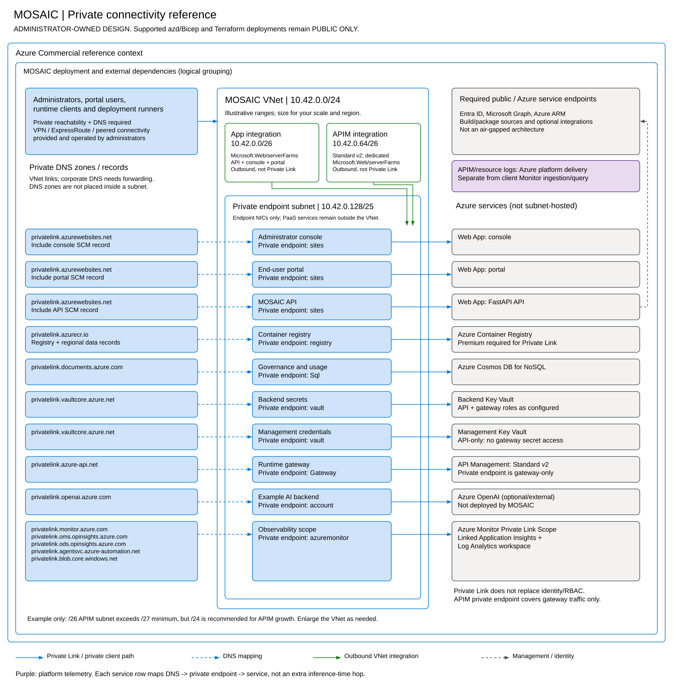
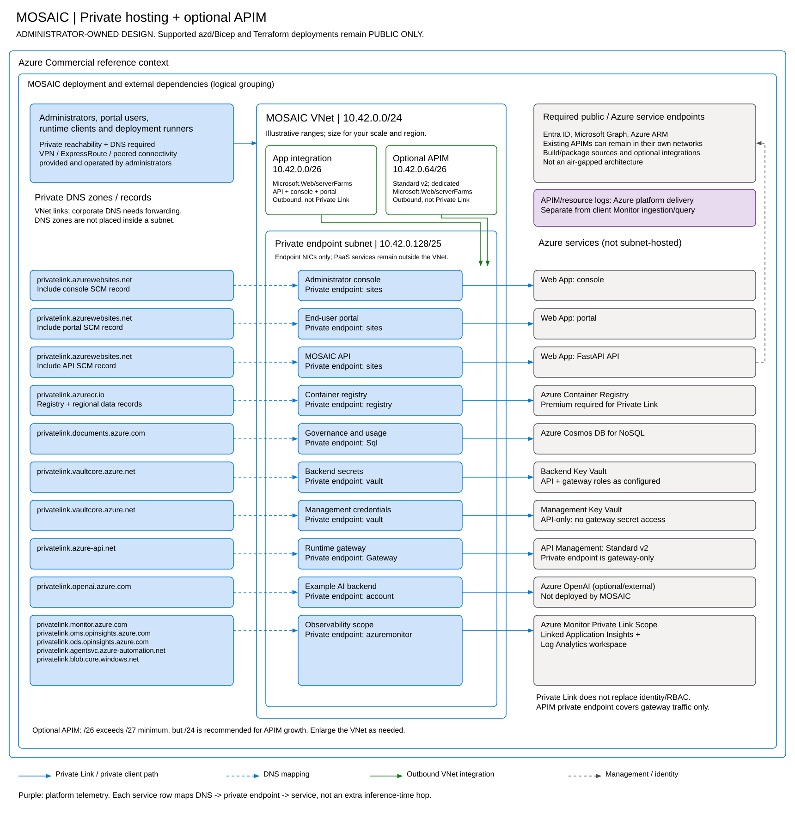

# Administrator-managed private networking

[Documentation](README.md) | [Deployment](deployment.md) | [Architecture](architecture.md)

**Design reference, not a deployment mode.** MOSAIC's supported Bicep/`azd up` and standalone
Terraform paths create the **public** reference deployment. Neither creates this networking.
Administrators can implement it through their own reviewed Terraform/IaC or the Azure portal,
and must own its validation, changes, and recovery.

**APIM is optional to deploy, including in a private design.** Both public deployment paths
default to MOSAIC-only hosting. Existing APIMs can remain in their own networks and be registered
afterward; they do not have to occupy MOSAIC's VNet. The primary example below therefore has
**no APIM integration subnet, APIM private endpoint or APIM private DNS zone**. Those are additions
only for an explicitly selected gateway design, not prerequisites or reserved capacity.



The diagram maps each service to a private endpoint and DNS configuration, while distinguishing
outbound integration and Azure platform services. All addresses are fictional design examples,
not an inventory of an existing deployment. Outer frames are logical context, not subscription
or resource-group membership: clients and shared/global services are external dependencies.
[Editable Excalidraw source](images/architecture/mosaic-private-networking.excalidraw).

## Address plan and boundaries

### MOSAIC-only hosting (primary example)

| Network | Example CIDR | Purpose and constraints |
| --- | --- | --- |
| MOSAIC VNet | `10.42.0.0/24` | Total example address space, not a production sizing recommendation |
| App integration | `10.42.0.0/26` | Outbound integration for API, console and portal; delegate to `Microsoft.Web/serverFarms` |
| Private endpoints | `10.42.0.128/25` | Private endpoint NICs for individual services; do not use an integration subnet |

`10.42.0.64/26` is **unallocated**, not a required or reserved APIM subnet. The `/24` is just a
total-space example: choose a different non-overlapping VNet/subnet plan if it better fits the
hosting services, service minimums, scaling and expected growth. No local gateway capacity needs
to be budgeted when you are only managing existing gateways elsewhere.

Azure reserves five addresses in each subnet. Private endpoints can consume multiple addresses:
ACR has registry and regional data endpoints; Azure Monitor's endpoint has multiple IP
configurations. Budget for those, service scale, upgrades, and future endpoints, not just the
number of endpoint resources. Integration also needs capacity during scale operations.
Do not overlap corporate, peered, VPN, or other Azure ranges. Regional App Service integration
must meet its region requirements; do not carry the public template's optional separate App
Service region into this one-VNet design without redesigning it.

### Optional co-located APIM example

Only if choosing Standard v2 with private inbound gateway access and outbound integration,
add a **dedicated** APIM integration subnet and an APIM endpoint/DNS record:

| Optional network addition | Example CIDR | Purpose and constraints |
| --- | --- | --- |
| APIM integration | `10.42.0.64/26` | Dedicated Standard v2 outbound integration; delegate to `Microsoft.Web/serverFarms`; associate required NSG |
| APIM private endpoint | Address(es) in `10.42.0.128/25` | Allocate endpoint capacity only when this gateway is part of the design |

<details>
<summary>Show the optional co-located gateway, its subnet, endpoint and DNS</summary>



This expanded example adds Standard v2 APIM integration and a gateway-only private endpoint,
plus an optional externally provisioned Azure OpenAI backend. Neither is required for MOSAIC
hosting. [Editable Excalidraw source](images/architecture/mosaic-private-networking-with-apim.excalidraw).

</details>

For **this optional design**, APIM Standard v2 requires at least `/27` for outbound integration
and recommends `/24` for growth. This compact `/26` example exceeds the minimum but deliberately
does **not** meet that growth recommendation. Use a larger VNet/address plan for that requirement. APIM's integration
VNet must be in the same subscription and region as the instance. Other existing APIM tiers
and topologies have different requirements; do not retrofit this subnet plan onto them.

PaaS service boxes sit outside the VNet: **their endpoint NICs**, not the services themselves,
are in the private-endpoint subnet. An inbound private endpoint does not supply outbound
connectivity. DNS zones are linked resources, not subnets.

## Service, endpoint, and DNS inventory

Use Azure Commercial zone names below. Other clouds, service kinds, custom hostnames, slots,
and multi-region registries need their own verified contracts.

| Service | Private Link target / group ID | Private DNS zone and records |
| --- | --- | --- |
| Administrator console Web App | Each app's `Microsoft.Web/sites` / `sites` | `privatelink.azurewebsites.net`; console hostname **and SCM** |
| End-user portal Web App | Its own site / `sites` | Same zone; portal hostname and SCM |
| MOSAIC API Web App | Its own site / `sites` | Same zone; API hostname and SCM |
| ACR | `Microsoft.ContainerRegistry/registries` / `registry` | `privatelink.azurecr.io`; registry and every required regional data endpoint |
| Cosmos DB for NoSQL | `Microsoft.DocumentDB/databaseAccounts` / `Sql` | `privatelink.documents.azure.com`; account/region records provided by the endpoint |
| Backend Key Vault | Its own `Microsoft.KeyVault/vaults` / `vault` | `privatelink.vaultcore.azure.net` |
| Management Key Vault | A separate vault / `vault` | Same zone, separate endpoint and records |
| **Optional** co-located APIM managed gateway | `Microsoft.ApiManagement/service` / `Gateway` | `privatelink.azure-api.net`; omit this endpoint/zone from MOSAIC-only hosting |
| Azure Monitor Private Link Scope (AMPLS) | `Microsoft.Insights/privateLinkScopes` / `azuremonitor` | `privatelink.monitor.azure.com`, `privatelink.oms.opinsights.azure.com`, `privatelink.ods.opinsights.azure.com`, `privatelink.agentsvc.azure-automation.net`, `privatelink.blob.core.windows.net` |
| **Optional** Azure OpenAI backend (expanded example only) | `Microsoft.CognitiveServices/accounts` / `account` | `privatelink.openai.azure.com`; omit when not using this backend; other Foundry/AI service kinds may also require different zones |

The APIM and AI-backend rows are optional additions to the primary inventory. Do not allocate
their endpoint addresses or create their zones merely because MOSAIC manages an existing gateway.
Management through ARM does not require the existing APIM's runtime gateway endpoint to be
inside MOSAIC's VNet. Arrange routes, DNS and access to an existing gateway/backend only where
your actual runtime or operational paths need them.

Create approved endpoint connections and private DNS zone groups. Link zones to the VNet(s)
whose clients need them; disable auto-registration for these private-link zone links.
Use Azure-created records rather than guessed private IPs. The two vaults share a DNS zone,
not a secret store or permission boundary. Likewise, three Web Apps share a zone, not an endpoint.

Applications and callers continue using their normal HTTPS service hostnames; do not configure
URLs using private IPs or replace normal hostnames with `privatelink` aliases. Preserve TLS
hostname validation and existing Entra audience/redirect settings.

For corporate DNS, configure conditional forwarding through a reachable Azure DNS Private
Resolver inbound endpoint or an administrator-managed DNS forwarder in Azure. Follow each
service's recommended public-zone forwarding pattern so its public CNAME chain resolves to the
linked private zone. On-premises clients cannot query Azure's `168.63.129.16` resolver directly.
Peering alone neither forwards DNS nor grants access to linked zones.

## Service configuration administrators must own

### Browser apps, API, and registry

Create **three** App Service private endpoints and separately integrate the apps outbound.
The browser itself calls both the console/portal and the API: making only the API server's
outbound path private does not give a user's browser access. Users and deployment runners need
working routes and DNS to all relevant app and SCM hostnames.

Private endpoints are available on supported App Service tiers including Basic; verify regional
VNet integration, scale and container-image routing for the selected plan. Explicitly configure
private registry image pulls through the integration path (for example
`vnetImagePullEnabled` on the site). Configure application/content routing as required by the
actual hosting model; an app private endpoint alone changes neither.

The public reference uses **Basic ACR**. ACR Private Link requires **Premium**, a deliberate
cost/tier change. Maintain each app identity's `AcrPull` assignment. DNS must resolve both login
and regional data endpoints. Verify a new container pull, not just an already cached image.

Default shared ACR Tasks/hosted build agents must not be assumed to reach a private registry.
Arrange a supported VNet-connected build mechanism (for example an appropriately configured
dedicated ACR Tasks agent pool where available, or a self-hosted builder), private push/pull
access, and access to required base-image/package sources. MOSAIC's public deployment helper
does not implement that private build path.

### Runtime gateway and AI backend

**Skip local gateway networking when deploying MOSAIC only.** Model/MCP runtime calls still need
an APIM, but that can be an existing service in another network, with its own client/backend
connectivity. Registering it does not deploy or move it.

The **optional expanded** APIM topology uses **Standard v2** with an inbound gateway private
endpoint and separate outbound VNet integration. If explicitly enabled, the public reference
creates **Developer**; classic VNet injection and v2 integration are different designs.
Do not copy v2 delegation/configuration
onto a classic injected service. Verify tier availability, capacity and any required replacement
before changing an existing instance.

APIM's private endpoint is **gateway-only**. It does not privatize ARM, all management endpoints,
or the developer portal. Its inbound endpoint does not let the gateway reach private backends.
The dedicated integration subnet needs the documented NSG and outbound Azure Key Vault
dependency rule, backend routes, DNS, and necessary public identity/service access.

The optional Azure OpenAI service is externally provisioned, with its own model deployment/quota,
private endpoint, DNS and approved gateway inference permissions. Neither public deployment path
creates it. API control-plane discovery through ARM and APIM runtime inference are separate
paths; a role assignment or successful inventory read proves neither private DNS nor routing.
MOSAIC's readiness result is not an authoritative private-network reachability test.

### Cosmos and the two vaults

Connect the API to Cosmos over its SQL/NoSQL endpoint and preserve its Cosmos data-plane role.
Configure Cosmos connectivity requirements for the actual client connection mode, not just a
generic HTTPS rule. Preserve `/tenantId` partitions and all existing data; networking is not a
reason to recreate containers.

Preserve API access to both vaults and configured gateway secret reads on the **backend** vault
only. Private Link does not authorize secrets; it must not grant APIM access to the management
credentials vault. Test both successful required operations and denied gateway management-secret
access with appropriately authorized non-production test identities.

### Application Insights and Log Analytics

Create or coordinate an **AMPLS**, link both the workspace and Application Insights component,
and connect its private endpoint/DNS zones. These are not independent generic private endpoints
placed directly on each monitoring resource.

Coordinate with the organization's DNS/monitoring owners before introducing AMPLS. Shared
Azure Monitor DNS can affect applications beyond MOSAIC; use a coherent AMPLS design for networks
sharing DNS, rather than independently overriding shared names. Include all affected resources
before restricting access.

Validate ingestion and query separately, select the AMPLS access modes deliberately, then apply
the corresponding resource public-access restrictions only when compatible clients work.
MOSAIC's API queries gateway logs, so verify its actual resource-context Log Analytics query,
not just a portal workspace query. APIM and other resource diagnostic delivery uses Azure's
platform pipeline; it is not evidence that gateway runtime traffic traversed the AMPLS NIC.
Check the documented platform-delivery behavior and real log arrival before tightening settings.

## Prerequisites and administrator implementation order

Before attempting private changes, arrange:

- Network/DNS ownership and change approval; non-overlapping IP capacity, supported regions/SKUs,
  permissions for endpoint approval, subnet join, NSGs, DNS zones/links and service configuration.
- VPN/ExpressRoute or peered routes for the relevant users/runners, a reachable DNS resolver,
  routing/security rules and a break-glass recovery path. These services are not deployed here.
- A private-capable image builder/deployment runner, package/base-image egress, access to SCM
  where required, and secure ownership of the custom IaC/state.

Implement in this order using your own Terraform or the matching service pages in the Azure portal:

1. Establish connectivity, CIDRs, subnets/delegations, NSGs/routes, DNS zones/links/forwarding,
   and planned SKU changes **for the selected services only**. Omit local APIM integration,
   endpoint and DNS when not deploying a gateway alongside MOSAIC. Account for UDRs, return
   routes, service tags and DNS TCP/UDP 53.
2. Create and approve per-service endpoints and zone groups; configure outbound integration,
   image-pull routing, AMPLS membership and monitoring modes. Preserve service identities/RBAC.
3. From the actual browser/client, runner, API and any configured gateway paths, validate
   normal-hostname DNS resolution to intended private IPs, TLS, authenticated operations, fresh
   image pulls, and actual telemetry ingestion/query. Keep management access available.
4. Only then disable the relevant public access. If privatizing an APIM gateway, it requires an
   established private endpoint before public gateway access can be disabled. A private
   endpoint's existence alone does not disable any service's public access.
5. Test allowed and disallowed networks, sign-in/callbacks, model calls, health probes, log
   freshness, deployment updates and recovery. Confirm failures are network restrictions rather
   than merely unauthenticated responses. Retain the successful configuration/evidence in your
   administrator-owned runbook.

Private does not mean offline: Entra token/metadata flows, Microsoft Graph, Azure management,
package sources and optional external integrations still need their documented paths. Do not
remove public egress indiscriminately or claim the design prevents all data exfiltration.
MOSAIC's outbound URL/SSRF safeguards remain in effect; do not broadly disable private-address
guards to make arbitrary MCP or billing URLs work.

## Updates and support boundary

**Do not rerun unmodified public templates over your customized private configuration.**
Both Bicep and Terraform explicitly express public access, default SKUs and app settings.
Subsequent applies can overwrite private changes or reopen public access. Portal edits are not
automatically reconciled or preserved. Terraform `ignore_changes` alone is not a complete private
deployment design.

Own a reviewed fork/custom deployment definition that preserves your networking, DNS, image
delivery and service lifecycle. Separate resource ownership if integrating shared hubs/zones;
never let two states/templates own the same resource. Review plans before every update.
MOSAIC supplies no supported private-provision/update/migration automation in this change.

To regenerate these fictional architecture assets (not application screenshots):

```powershell
python scripts\architecture\private_networking.py
```

## Azure configuration references

- [APIM networking options](https://learn.microsoft.com/azure/api-management/virtual-network-concepts),
  [Standard v2 outbound requirements](https://learn.microsoft.com/azure/api-management/integrate-vnet-outbound),
  and [gateway private endpoints](https://learn.microsoft.com/azure/api-management/private-endpoint)
- [App Service private endpoints and SCM DNS](https://learn.microsoft.com/azure/app-service/overview-private-endpoint)
  and [VNet integration routing](https://learn.microsoft.com/azure/app-service/configure-vnet-integration-routing)
- [ACR private endpoints](https://learn.microsoft.com/azure/container-registry/container-registry-private-endpoints)
- [Private endpoint DNS zone inventory](https://learn.microsoft.com/azure/private-link/private-endpoint-dns)
  and [hybrid DNS](https://learn.microsoft.com/azure/private-link/private-endpoint-dns-integration)
- [Azure Monitor design](https://learn.microsoft.com/azure/azure-monitor/fundamentals/private-link-design)
  and [configuration](https://learn.microsoft.com/azure/azure-monitor/fundamentals/private-link-configure)
