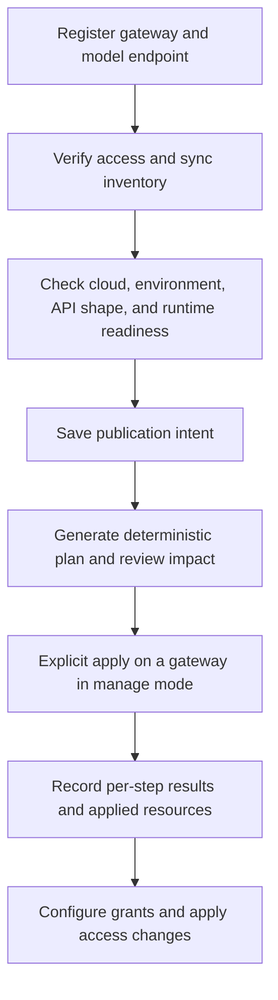
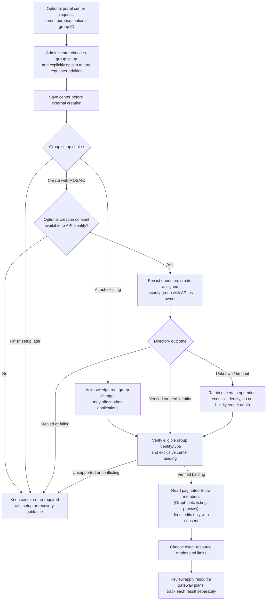
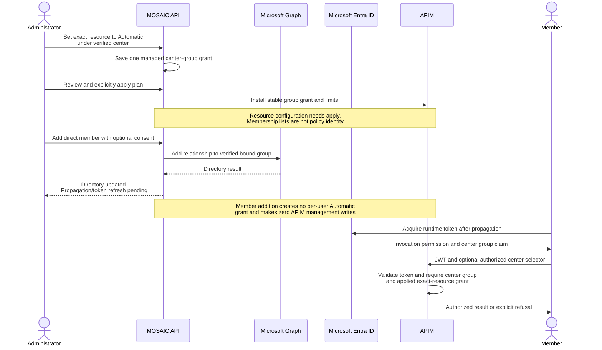
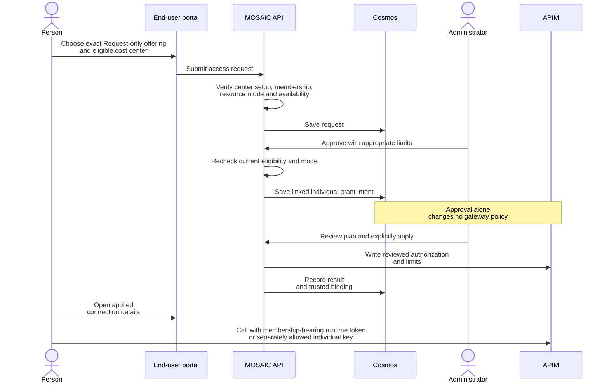
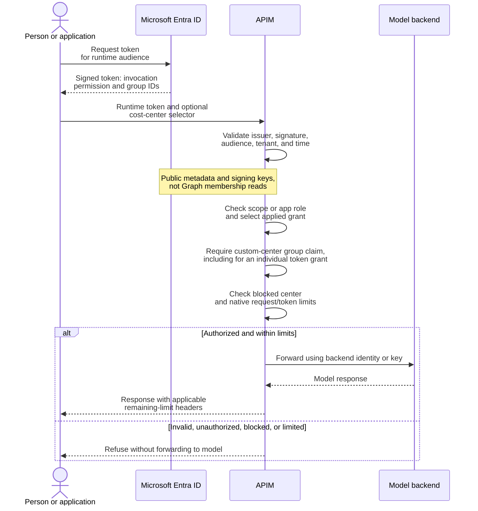
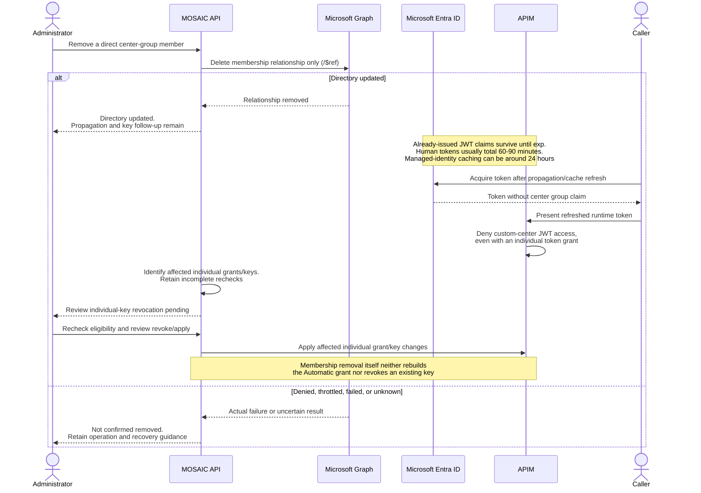
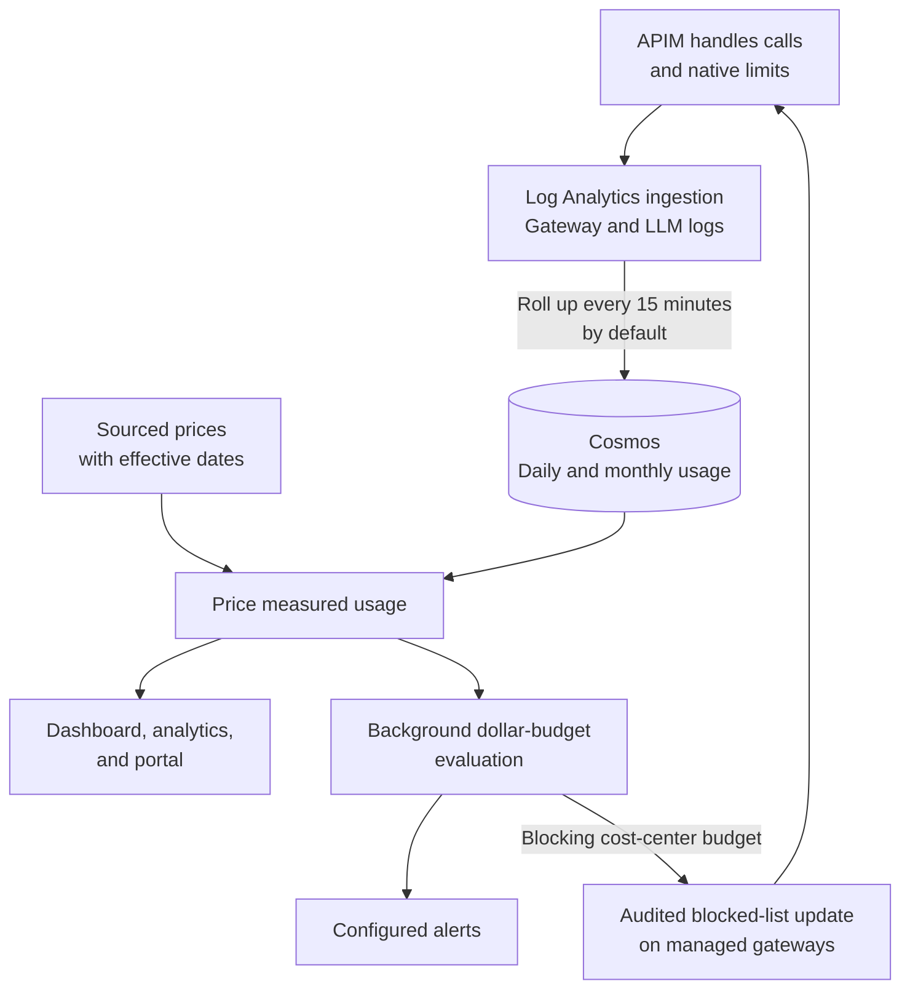
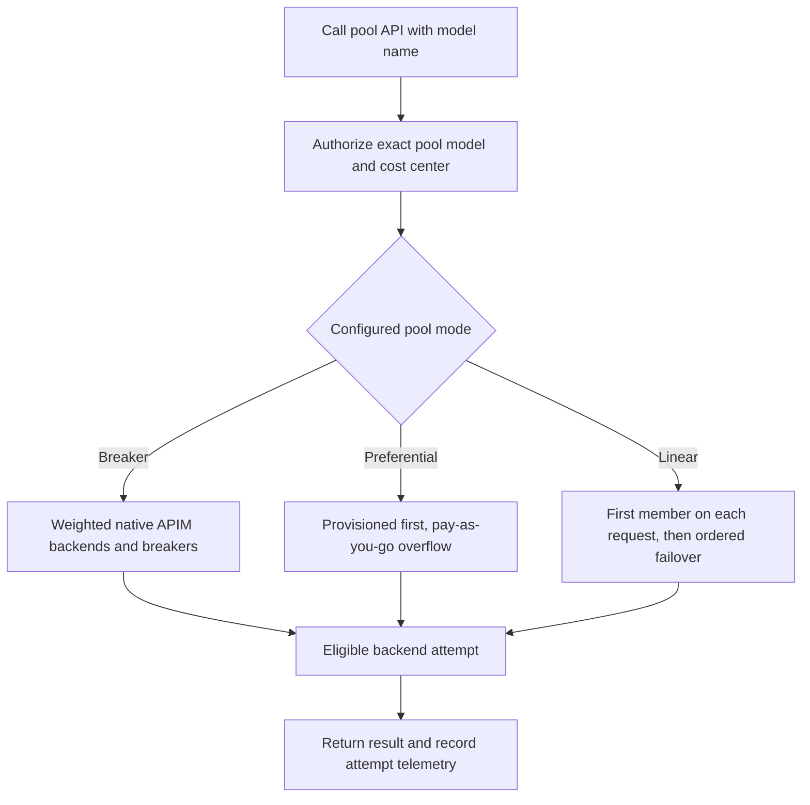

# MOSAIC workflows

[Documentation](README.md) | [Architecture](architecture.md) | [FAQ](faq.md)

The diagrams distinguish **saved intent**, **applied gateway configuration**, and **asynchronous
feedback**. Moving through one does not automatically complete the others.

- [Onboard and publish a model](#onboard-and-publish-a-model)
- [Set up an Entra-backed cost center](#set-up-an-entra-backed-cost-center)
- [Inherit Automatic access](#inherit-automatic-access)
- [Request access and make it effective](#request-access-and-make-it-effective)
- [Runtime call with an Entra security-group grant](#runtime-call-with-an-entra-security-group-grant)
- [Remove a member and finish credential revocation](#remove-a-member-and-finish-credential-revocation)
- [Usage, pricing, and dollar-budget feedback](#usage-pricing-and-dollar-budget-feedback)
- [Route a model through a pool](#route-a-model-through-a-pool)

## Onboard and publish a model

MOSAIC needs control-plane permission to observe or change resources; the gateway separately needs
a network path and suitable credential/identity permissions to call the backend. A successful
inventory read is not proof of runtime inference access.

Import/adoption records existing APIs without taking over their policies. Optional creation of a
new Azure model deployment requires endpoint opt-in, permission/quota checks, and its own explicit
billing-aware review; it does not complete publication, grants, or pool membership.

See [gateways](gateways.md), [model endpoints](model-endpoints.md), and [model publishing](model-publishing.md).

## Set up an Entra-backed cost center

This is the custom-center workflow. General is exempt from the mandatory group; Government
offerings are not available in the new workflow.

An approved center request links to one saved center even when setup is incomplete. It does not
silently add the requester, create resource grants, or prove gateway readiness. A verified group
without membership-write consent has a read-only Members view, not an unverified binding.
Setup/capability checks are read-only; they do not create or delete sacrificial groups.
The direct member listing uses the Graph beta workaround for service principals missing from v1.0.
That preview listing dependency is not production-supported; APIM's stable JWT group-claim path
is separate. No live interoperability is established by these diagrams or fictional adapters.

See [center setup and recovery](cost-centers.md#set-up-cost-centers) and
[optional directory consent](deployment.md#optional-cost-center-group-management).

## Inherit Automatic access

Automatic is a resource mode, **not scheduled approval of personal requests**. It requires
caller-side Entra token support on the exact publication; a backend API key does not prevent it.

The sequence shows a successful directory write, not a guarantee of immediate claims. Failed or
unknown operations remain visible. Inherited access gives no group key or automatically generated
personal key. Explicit individual keys remain a separate eligible-grant path where enabled.

See [resource modes](cost-centers.md#resource-access-modes) and [keys](cost-centers.md#keys).

## Request access and make it effective

A scheduled approval policy can replace the manual resource approval step, not the gateway apply.
It still creates an individual grant and is different from a center's Automatic resource mode.
The offering, environment, and cost center remain explicit even when the portal groups visually
similar models. Not available blocks new requests/grants server-side. Security-group grants are
token-only; direct model grants can allow tokens, keys, or both according to resource and center
settings. For a custom center, an individual token grant still requires its group claim.
Default-center preferences are not membership. Government's separate key-only workflow is unchanged
and is excluded from these new center modes.

For an MCP server that calls a model, authorize two independent legs: the client's grant to the
MCP server and the server identity's grant to the model. One grant does not authorize the other.

See [grants](access.md), [approvals](approvals-and-notifications.md), and
[MCP servers that call models](mcp-servers-that-call-models.md).

## Runtime call with an Entra security-group grant

This is the commercial token path. No directory lookup occurs during the inference call.

The backend credential is separate from the caller's token. APIM compares group **object IDs**
from the validated JWT; it does not ask MOSAIC or Graph to resolve names or membership.
Invocation scopes/app roles and the resource grant are both required. App/agent callers need
their application role directly or through supported blueprint inheritance.

Existing token claims can outlive a membership change. A group-overage token cannot prove the
required custom-center membership; a direct token grant does not bypass that check. General
retains its exempt direct-token path. An enabled eligible direct grant wins over group grants
within the selected center; group counters are per member.

See [identity boundaries](architecture.md#which-identity-needs-which-access) and
[Entra calls](call-models-with-entra-tokens.md).

## Remove a member and finish credential revocation

The relevant delay after removal is the token's **remaining** lifetime, plus directory/cache
behavior, not a universal 90-minute window. There is no immediate
JWT invalidation or CAE promise for this path.

If membership changed outside MOSAIC, explicitly recheck individual-key eligibility and finish
revoke/apply. There is no directory watcher to discover and revoke keys automatically. Removing
one direct relationship also does not remove a separate inherited membership path.

See [removal and credentials](cost-centers.md#removing-a-member).

## Usage, pricing, and dollar-budget feedback

The remaining-quota response header comes from APIM's native counter, **not this pipeline**.
The pipeline supplies reporting, price estimates, forecasts, and dollar-budget decisions.
Monthly dollar budgets aggregate gateways; pooled native quotas remain gateway-scoped.

Dollar-budget blocking normally trails usage by 15-30 minutes and can overshoot. Missing prices,
ingestion delay, worker downtime, or failed blocked-list updates weaken the protection. An
organization budget only warns. Alerts additionally depend on enabled workers, recipient
preferences, and provider readiness; saved settings do not prove delivery.

See [usage analytics](usage-analytics.md), [pricing](pricing.md), [budgets](budgets-and-alerts.md),
and [notification readiness](approvals-and-notifications.md).

## Route a model through a pool

The caller sees the pool's model name and base URL, not its deployment topology. Pools do not
relax cloud, environment, API-shape, or readiness checks, and their models retain separate grants
and limits. Native breakers do not apply uniformly to every member: key-authenticated targets
are separately attempted, and linear pools do not use breakers.

This diagram summarizes routing choices, not a guarantee of successful failover. Breaker behavior,
retryable responses, token-metering support, and excluded APIs are described in [model pools](model-pools.md).
